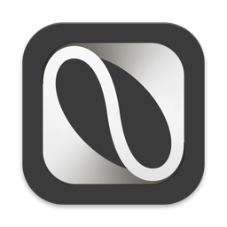
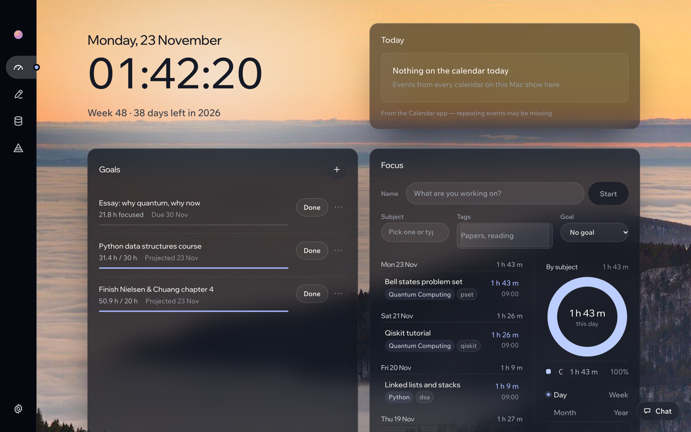
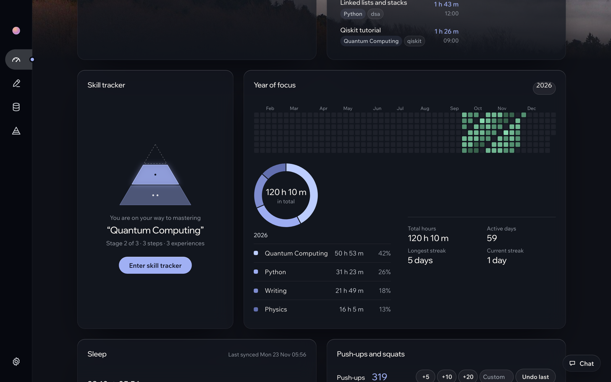
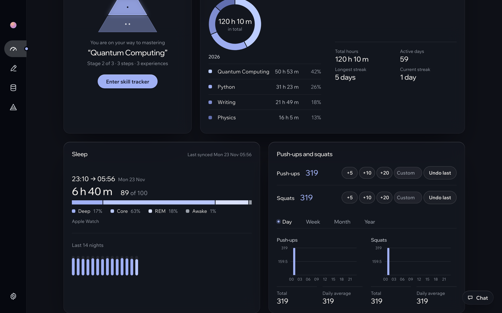
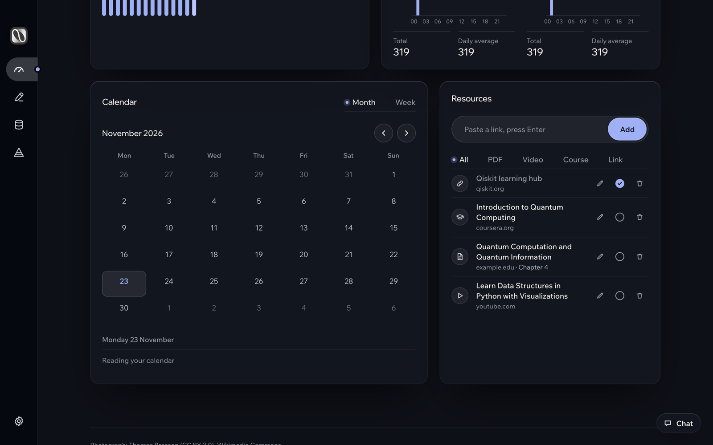
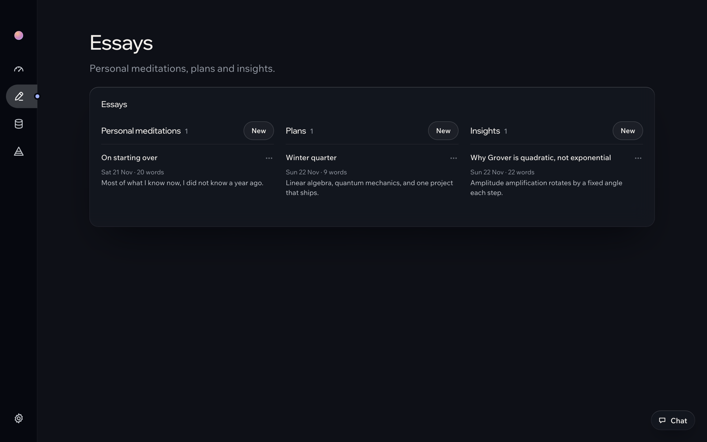
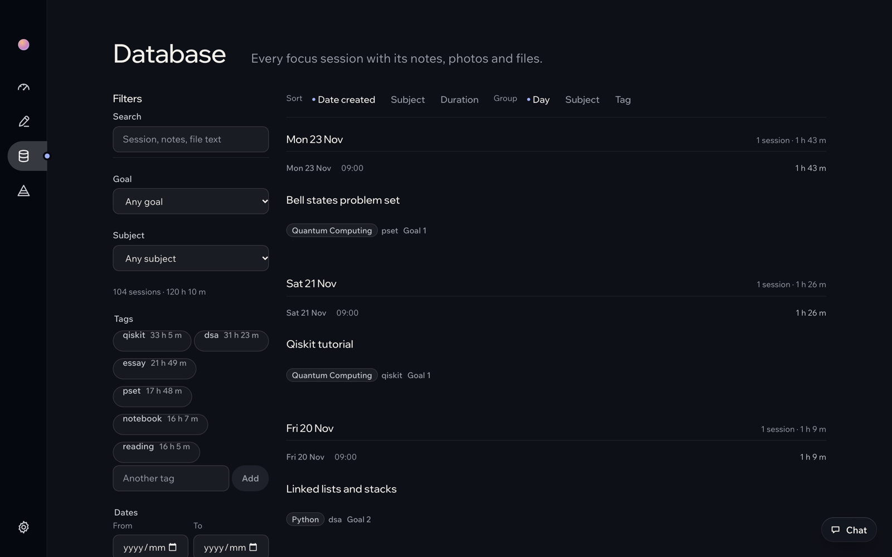
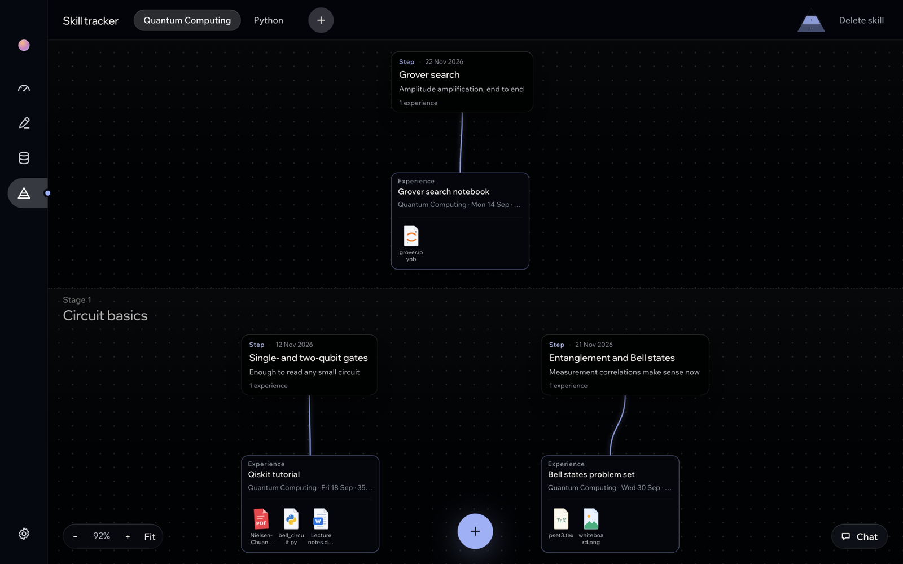
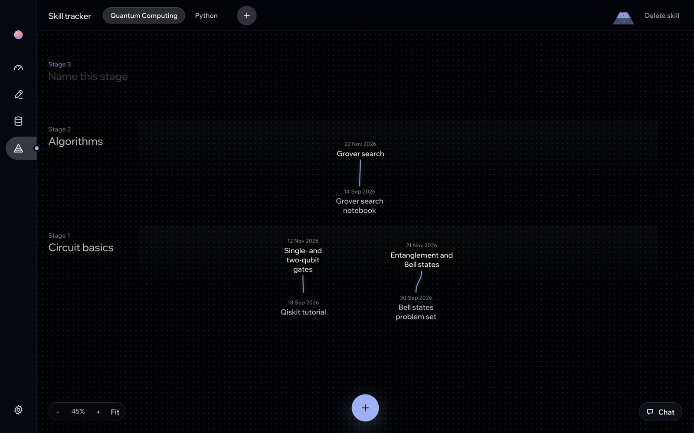

<p align="center"></p>

<h1 align="center">Next</h1>

<p align="center">A personal hub for focus, writing and progress, running on your own Mac.</p>



Next is a personal hub that runs on your own Mac. You run focus sessions from it, drop in the files and photos from each session, write essays, track goals, sleep and exercise, map how a skill is coming along, and ask a chat sidebar questions that it answers from your own data.

Everything stays local: one SQLite file and a folder of attachments on your Mac. A native macOS window wraps the web app, and your iPhone can reach it over Tailscale while the Mac is awake.

It's built for one person. There are no accounts, no cloud hosting and no sample data: an empty panel says it's empty.

## What's in it

Screenshots show demo data.

### Dashboard
- **Time and today**: a live clock, the date, the week number and today's agenda, over a drifting fog photograph.
- **Goals**: type a goal and give it a deadline, planned hours, or both. Each row shows hours focused, a progress bar and a projected finish based on your pace over the last 14 days. Rows turn apricot when a goal is at risk. Finished goals record planned against actual, and the hub keeps a running figure for how accurate your estimates are.
- **Focus**: start a session with a name, a subject, tags and an optional goal. Pause and resume as needed. The timer lives on the server, so a reload or a crash never loses it, and paused time never counts. On stop, add notes, take a photo or upload files. Photos of handwriting are read into LaTeX by Claude vision; other photos get a one-line caption. A history list and pies by subject cover the day, week, month and year.
- **Skill tracker**: the skill you touched last, drawn as a pyramid you climb.
- **Year of focus**: a GitHub-style heatmap of the year, with a pie for the year or for any day you hover, plus totals and streaks.
- **Sleep**: last night's times, stages and a 0–100 quality score, and a strip of the last 14 nights. An iPhone Shortcut sends the data from Apple Health each day.
- **Push-ups and squats**: quick-add buttons and day, week, month and year charts.
- **Calendar**: a month grid and week list read from the Calendar app (iCloud, Google, subscribed calendars). Read-only.
- **Resources**: paste a link and the hub fetches its title and sorts it as a PDF, video, course or link.
- **Now playing**: previous, play/pause and next for whatever is playing, with track info where macOS allows it.







### Essays
Three columns: Personal meditations, Plans and Insights. The editor works like a word processor: styles, fonts, lists, tables, images, links, inline and block math, find and replace, and a live word count. It autosaves within a second of your last keystroke and keeps the last 30 snapshots. Essays export to `.docx` or PDF.



### Database
Every focus session with its notes and attachments, filtered by search, subject, tag, date, file type, goal or source. Images (including HEIC), PDFs, code, notebooks and LaTeX all preview in place. Code and text files can sync both ways with a private GitHub repository.

A chat sidebar answers from your data: goals, focus totals, sessions, essays, LaTeX from photos, synced code, sleep and exercise. It can only read; it never changes anything.



### Skills
One canvas per skill, split into stages stacked upward from the foundations. You name each stage yourself.
- **Steps** are what you learned: a card with the day you completed it, a title and a line on what it opened up. Cards grow with their text.
- **Experiences** are focus sessions, with their files drawn as small icons (a red PDF, a page with the Python snakes, a Word document, and so on). Click a file to open it.
- Drop an experience on a step to link them. Drag cards up a stage as the work gets harder; each stage grows to hold what's in it.
- Zoom out and the cards fade to their titles and dates, joined by lines, so a crowded skill still reads at a glance.





### Settings
The hub passcode and token, the iPhone Shortcut instructions for sleep, Tailscale setup for phone access, the GitHub sync repository, and a switch to keep the Mac awake while it's plugged in.

## Requirements

- macOS on Apple silicon (built and used on macOS 26)
- **Node 26 or newer**: the server runs its TypeScript directly
- The Swift toolchain (the Xcode Command Line Tools are enough) for the native window and the Calendar and media helpers
- Optional:
  - access to Claude (`ANTHROPIC_BASE_URL` and `ANTHROPIC_AUTH_TOKEN`) for the chat and for reading photos
  - the GitHub CLI (`gh`), logged in, for GitHub sync
  - Tailscale, for phone access

## Getting started

```bash
git clone https://github.com/MaxLannal/Next-app.git
cd Next-app
npm install
npm run setup
```

`npm run setup` walks through everything, and each step is safe to repeat:
- builds the web app and the Swift helpers
- writes the config, picking up the Claude settings from your shell
- checks the Claude model
- asks for Calendar and Accessibility permission
- sets the passcode your phone will use

Two flags add more:

```bash
npm run setup -- --launchd
```

starts the hub at login, and

```bash
npm run setup -- --install-app
```

copies the app to `~/Applications`.

The hub serves on <http://localhost:4747>. Requests from the Mac itself need no login; any other device (your phone over Tailscale) asks for the passcode once.

## Day-to-day commands

Run these from the repository root:

| Command | What it does |
| --- | --- |
| `npm start` | Run the server, serving the built web app |
| `npm run dev` | Server with reload, plus the Vite dev server on port 5173 |
| `npm run build` | Build the web app into `web/dist` |
| `npm run app` | Build the native macOS app into `dist/` |
| `npm test` | Unit and API tests (Vitest) |
| `npm run typecheck` | TypeScript checks for the server and the web app |
| `npm run e2e` | Browser smoke test (Playwright) |

The native app is a thin window: it starts `node server/main.ts` from this folder and shows the page. After changing web code, run `npm run build` and reload the window (⌘R). After changing server code, quit and reopen the app.

## Where your data lives

Everything is in `~/PersonalHub/` (set `HUB_DATA_DIR` to use a different folder):

| Path | What's there |
| --- | --- |
| `hub.db` | The SQLite database |
| `files/` | Original attachments, by year and month |
| `repo/` | The local clone used for GitHub sync |
| `config.json` | Claude settings, hub passcode and token, GitHub repository, preferences |
| `backups/` | A nightly copy of the database; the last 14 are kept |

The database upgrades itself one version at a time when the server starts, so an older `hub.db` keeps its data.

## How it's built

- **Web app** (`web/`): React, Vite and TanStack Query; TipTap for the essay editor, KaTeX for math, Shiki for code.
- **Server** (`server/`): Hono on Node, `node:sqlite` with full-text search, and a small job queue for photo reading and GitHub sync.
- **Shared types** (`shared/`): used by both sides.
- **macOS** (`mac/`):
  - `HubApp` is the native window (AppKit and WebKit).
  - `calendar-helper` reads events through EventKit.
  - `media-helper` sends media keys.
- **Look**: the Dusk theme from [Nutlope/hallmark](https://github.com/Nutlope/hallmark); see [`docs/dusk-theme.md`](docs/dusk-theme.md).

## Credits

The fog photograph is by Thomas Bresson (CC BY 3.0, Wikimedia Commons). Other third-party notices are in [`THIRD_PARTY_NOTICES.md`](THIRD_PARTY_NOTICES.md).
